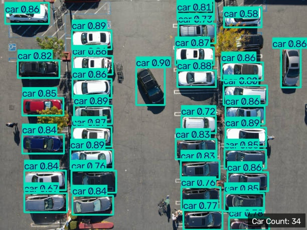

# Aerial Car Detection and Counting with YOLOv8 on VisDrone

## Overview

In this project, I used YOLOv8 to detect vehicles in aerial images and videos. I fine-tuned a YOLOv8n model on the VisDrone dataset and used the trained model mainly for car detection.

I also added a vehicle counting method for aerial videos. Since the camera is moving, I estimated the camera motion using optical flow and then used DBSCAN clustering to reduce duplicate vehicle counts.

## Features

- Car detection in aerial images
- Car detection in aerial videos
- Fine-tuned YOLOv8n model on the VisDrone dataset
- Vehicle counting in moving-camera videos
- Camera motion estimation using optical flow
- Duplicate count reduction using DBSCAN clustering
- Local output generation for images and videos

## Project Structure

```text
aerial-car-detection-counting-yolov8/
├── assets/
│   ├── results/
│   │   └── detected_sample_image.jpg
│   ├── sample_image.JPG
│   └── sample_video.mp4
├── models/
│   └── best.pt
├── outputs/
│   ├── car_detection/
│   └── car_tracking/
├── src/
│   ├── train.py
│   ├── detect.py
│   └── track.py
├── .gitignore
├── requirements.txt
└── README.md
```

The `outputs` directory is created automatically when the scripts are run and is ignored by Git.

## Installation

Clone the repository:

```bash
git clone https://github.com/ParmidaHnd/aerial-car-detection-counting-yolov8.git
cd aerial-car-detection-counting-yolov8
```

Install the required packages:

```bash
pip install -r requirements.txt
```

## Usage

To run car detection on the sample image and video:

```bash
python src/detect.py
```

To run vehicle tracking and counting:

```bash
python src/track.py
```

## Training

To train the YOLOv8n model on the VisDrone dataset:

```bash
python src/train.py
```

The model is trained for 20 epochs with an image size of 640.

## Model Performance

The model was evaluated on the VisDrone validation set. The car detection results are shown below:

| Class | Precision | Recall | mAP@50 | mAP@50:95 |
|---|---:|---:|---:|---:|
| Car | 0.573 | 0.722 | 0.713 | 0.478 |

For the car class, the model achieved an mAP@50 of 0.713 and a recall of 0.722.

## Results

Here is an example of the car detection result on an aerial image:



## How It Works

The project has two main parts:

1. **Detection:**  
   The trained YOLOv8 model detects cars in aerial images and video frames.

2. **Tracking and Counting:**  
   For moving-camera videos, optical flow is used to estimate camera motion. The detected car positions are then grouped using DBSCAN clustering to reduce duplicate counts and estimate the number of unique vehicles.

## Limitations

- The vehicle count is based on camera-motion compensation and clustering, so some cars may still be counted incorrectly.
- Counting performance depends on the quality of the detections.
- The method is mainly designed for aerial videos with a moving camera.
- Fast vehicle motion or large camera motion can reduce counting accuracy.